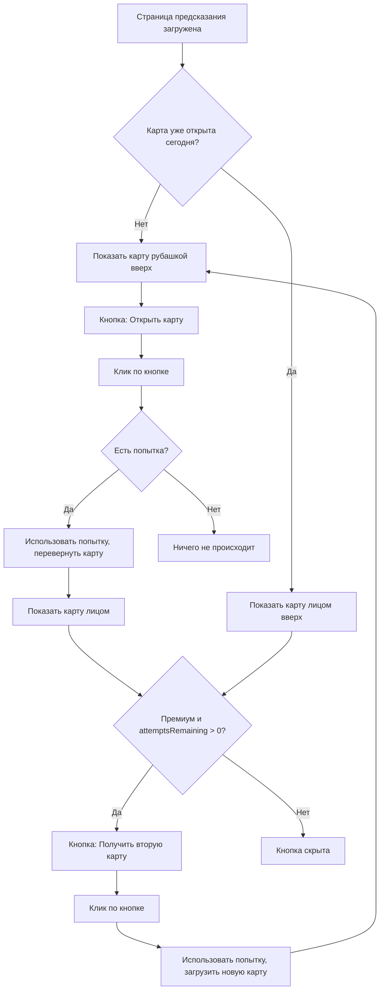

# План: Изменение фона, рекламы и кнопки на странице предсказания

## 1. Изменение фона приложения (все страницы)

### Текущее состояние
- Все страницы используют `url('/assets/ui/blue.png')` как фон — тёмно-синий градиент
- Фон задан в `body` в [`src/app/app.scss`](src/app/app.scss:13) и переопределён в каждом компоненте

### Что нужно сделать
- Заменить тёмно-синий фон (`blue.png`) на почти белый с очень слабым голубоватым оттенком
- Использовать CSS-градиент вместо изображения: `linear-gradient(180deg, #F5F8FC 0%, #EBF0F7 100%)`
- Обновить цвета текста для контраста на светлом фоне

### Файлы для изменения
| Файл | Что менять |
|------|-----------|
| [`src/app/app.scss`](src/app/app.scss:13) | `background: url('/assets/ui/blue.png')` → `background: linear-gradient(180deg, #F5F8FC 0%, #EBF0F7 100%)` |
| [`src/app/pages/home/home.scss`](src/app/pages/home/home.scss:11) | То же самое |
| [`src/app/pages/prediction/prediction.scss`](src/app/pages/prediction/prediction.scss:5) | То же самое |
| [`src/app/pages/collection/collection.scss`](src/app/pages/collection/collection.scss:3) | То же самое |
| [`src/app/pages/question/question.scss`](src/app/pages/question/question.scss:3) | То же самое |

---

## 2. Удаление рекламы для бесплатного пользователя

### Текущее состояние
- Бесплатный пользователь: 1 попытка в день + 1 через просмотр рекламы ([`src/app/services/attempt.ts`](src/app/services/attempt.ts:30))
- Есть модальное окно с рекламой ([`prediction.html`](src/app/pages/prediction/prediction.html:76-88))
- Есть иконка рекламы 🎬 ([`prediction.html`](src/app/pages/prediction/prediction.html:61-64])
- Есть текст подсказки про рекламу ([`prediction.html`](src/app/pages/prediction/prediction.html:66])
- Методы `canWatchAd()`, `watchAd()`, `showAdModal`, `showNewCardButton`, `isNewCardAfterAd` в компоненте

### Что нужно сделать
- Убрать весь механизм рекламы:
  - Удалить модальное окно с рекламой из HTML
  - Удалить иконку рекламы 🎬
  - Удалить текст подсказки про рекламу
  - Удалить методы `watchAd()`, `getNewCardAfterAd()`, `closeAdModal()`, `showAdModal`, `showNewCardButton`, `isNewCardAfterAd`
  - Упростить логику `flipCard()` — убрать ветку `canWatchAd()`
  - Упростить логику `drawNewCard()` — убрать ветку `canWatchAd()`
- В сервисе `Attempt`:
  - Убрать `AD_WATCHED_KEY` и все связанные методы
  - Убрать `canWatchAd()`, `watchAd()`, `hasUsedAdAttempt()`
  - Убрать `resetForNewCard()`
  - Упростить `resetIfNeeded()` — убрать логику сброса ad-флага
  - Убрать `refreshPredictionAttempts()` — не нужен, т.к. премиум уже имеет 2 попытки через `resetIfNeeded()`

### Файлы для изменения
| Файл | Что менять |
|------|-----------|
| [`src/app/pages/prediction/prediction.html`](src/app/pages/prediction/prediction.html) | Удалить модальное окно, иконку рекламы, подсказку, кнопки `btn-get-new` и `btn-draw-new` |
| [`src/app/pages/prediction/prediction.ts`](src/app/pages/prediction/prediction.ts) | Удалить методы и поля, связанные с рекламой |
| [`src/app/pages/prediction/prediction.scss`](src/app/pages/prediction/prediction.scss) | Удалить стили `.btn-get-new`, `.btn-draw-new`, `.modal-overlay`, `.modal` |
| [`src/app/services/attempt.ts`](src/app/services/attempt.ts) | Удалить `AD_WATCHED_KEY`, методы `canWatchAd()`, `watchAd()`, `hasUsedAdAttempt()`, `resetForNewCard()` |

---

## 3. Новая логика кнопки на странице предсказания

### Текущее состояние
- Карта открывается по клику на саму карту ([`prediction.html`](src/app/pages/prediction/prediction.html:5))
- Кнопки находятся внутри белой плашки `.controls` ([`prediction.html`](src/app/pages/prediction/prediction.html:44-72])
- Белая плашка имеет `background: rgb(255, 255, 255)` ([`prediction.scss`](src/app/pages/prediction/prediction.scss:182])

### Новая логика

#### Состояния кнопки:

| Состояние | Условие | Текст кнопки |
|-----------|---------|-------------|
| **Карта не открыта** (рубашка вверх) | `!showCardFace && !showPrediction` | "Открыть карту" |
| **Карта открыта, премиум, есть попытка** | `(showCardFace \|\| showPrediction) && isPremium && attemptsRemaining > 0` | "Получить вторую карту" |
| **Карта открыта, нет попыток** | `(showCardFace \|\| showPrediction) && attemptsRemaining <= 0` | Кнопка скрыта |

#### Визуальный дизайн кнопки (iOS-стиль):
- Светлый фон: `background: #FFFFFF` или `#F2F2F7` (как iOS)
- Тёмный текст: `color: #007AFF` (iOS blue) или `#0a1e3d`
- Скругление: `border-radius: 14px` (iOS-style)
- Тень: `box-shadow: 0 2px 8px rgba(0, 0, 0, 0.08)`
- Жирный шрифт: `font-weight: 600`
- Размер: `padding: 16px 32px`, `font-size: 1.2rem`
- Отступ под картой: `margin-top: 40px`

#### Расположение:
- Кнопка находится **под картой** с красивым отступом (`margin-top: 40px`)
- **Убираем белую плашку `.controls`** — кнопка стоит на фоне страницы
- Под кнопкой — счётчик попыток (текст "Осталось попыток: X / Y")

### Файлы для изменения
| Файл | Что менять |
|------|-----------|
| [`src/app/pages/prediction/prediction.html`](src/app/pages/prediction/prediction.html) | Заменить `.controls` на новую структуру: кнопка + счётчик попыток |
| [`src/app/pages/prediction/prediction.ts`](src/app/pages/prediction/prediction.ts) | Обновить логику: кнопка вызывает `flipCard()` или `drawNewCard()` |
| [`src/app/pages/prediction/prediction.scss`](src/app/pages/prediction/prediction.scss) | Заменить стили `.controls` на новые стили для кнопки и счётчика |

---

## 4. Детальный план изменений в каждом файле

### 4.1 [`src/app/app.scss`](src/app/app.scss)
```scss
// Заменить:
background: url('/assets/ui/blue.png') center center / cover no-repeat fixed;

// На:
background: linear-gradient(180deg, #F5F8FC 0%, #EBF0F7 100%) center center / cover no-repeat fixed;
```

### 4.2 [`src/app/pages/home/home.scss`](src/app/pages/home/home.scss)
```scss
// Заменить строку 11:
background: url('/assets/ui/blue.png');
// На:
background: transparent;

// Возможно, скорректировать цвета текста для светлого фона
```

### 4.3 [`src/app/pages/prediction/prediction.scss`](src/app/pages/prediction/prediction.scss)
```scss
// Заменить строку 5:
background: url('/assets/ui/blue.png');
// На:
background: transparent;

// Полностью переписать .controls:
// - Убрать background: rgb(255, 255, 255)
// - Убрать padding, border-radius
// - Сделать контейнером для кнопки и счётчика

// Добавить стили для новой кнопки (iOS-стиль):
.btn-action {
  background: #FFFFFF;
  color: #007AFF;
  border: none;
  border-radius: 14px;
  padding: 16px 32px;
  font-size: 1.2rem;
  font-weight: 600;
  cursor: pointer;
  box-shadow: 0 2px 8px rgba(0, 0, 0, 0.08);
  transition: all 0.2s ease;
  width: 100%;
  max-width: 320px;
  
  &:hover {
    transform: translateY(-2px);
    box-shadow: 0 4px 12px rgba(0, 0, 0, 0.12);
  }
  
  &:active {
    transform: translateY(0);
    box-shadow: 0 1px 4px rgba(0, 0, 0, 0.06);
  }
}

// Счётчик попыток под кнопкой:
.attempts-counter {
  text-align: center;
  font-size: 1rem;
  color: #8E8E93; // iOS secondary label
  margin-top: 12px;
  
  .attempt-count {
    font-weight: 600;
    color: #0a1e3d;
  }
}
```

### 4.4 [`src/app/pages/prediction/prediction.html`](src/app/pages/prediction/prediction.html)
```html
<!-- Вместо сложной логики с btn-get-new, btn-draw-new, controls, modal -->

<!-- Кнопка под картой -->
<div class="button-section" *ngIf="showButton">
  <button class="btn-action" (click)="onActionButtonClick()">
    {{ buttonText }}
  </button>
  <div class="attempts-counter">
    Осталось попыток: <span class="attempt-count">{{ attemptsRemaining }}</span> / {{ maxAttemptsPerDay }}
  </div>
</div>

<!-- Таймер (когда нет попыток) -->
<p class="timer-line" *ngIf="attemptsRemaining <= 0 && showPrediction">
  Следующая карта через: <strong>{{ timer }}</strong>
</p>
```

### 4.5 [`src/app/pages/prediction/prediction.ts`](src/app/pages/prediction/prediction.ts)
```typescript
// Добавить вычисляемые свойства:

get showButton(): boolean {
  // Кнопка показывается когда:
  // 1. Карта ещё не открыта (рубашка вверх)
  // 2. Или карта открыта, и у премиума есть ещё попытка
  if (!this.showCardFace && !this.showPrediction) {
    return true; // "Открыть карту"
  }
  if ((this.showCardFace || this.showPrediction) && this.isPremium && this.attemptsRemaining > 0) {
    return true; // "Получить вторую карту"
  }
  return false;
}

get buttonText(): string {
  if (!this.showCardFace && !this.showPrediction) {
    return 'Открыть карту';
  }
  if ((this.showCardFace || this.showPrediction) && this.isPremium && this.attemptsRemaining > 0) {
    return 'Получить вторую карту';
  }
  return '';
}

onActionButtonClick(): void {
  if (!this.showCardFace && !this.showPrediction) {
    // Карта не открыта — открываем (флипаем)
    this.flipCard();
  } else if ((this.showCardFace || this.showPrediction) && this.isPremium && this.attemptsRemaining > 0) {
    // Премиум хочет вторую карту
    this.drawNewCard();
  }
}

// Упростить flipCard() — убрать ветку canWatchAd()
// Упростить drawNewCard() — убрать ветку canWatchAd()
// Удалить: watchAd(), getNewCardAfterAd(), closeAdModal(), showAdModal, showNewCardButton, isNewCardAfterAd
```

### 4.6 [`src/app/services/attempt.ts`](src/app/services/attempt.ts)
```typescript
// Удалить:
private readonly AD_WATCHED_KEY = 'cardGameAdWatched';

// Упростить resetIfNeeded():
// Убрать блок с AD_WATCHED_KEY
// Для премиума: initialAttempts = 2
// Для бесплатного: initialAttempts = 1

// Удалить методы:
canWatchAd(): boolean { ... }
watchAd(): void { ... }
hasUsedAdAttempt(): boolean { ... }
resetForNewCard(): void { ... }

// Убрать AD_WATCHED_KEY из refreshPredictionAttempts()
```

### 4.7 Другие страницы (фон)
- [`src/app/pages/collection/collection.scss`](src/app/pages/collection/collection.scss:3): `background: url('/assets/ui/blue.png')` → `background: transparent`
- [`src/app/pages/question/question.scss`](src/app/pages/question/question.scss:3): `background: url('/assets/ui/blue.png')` → `background: transparent`

---

## 5. Схема работы новой логики



---

## 6. Порядок выполнения задач

1. **Изменить фон** во всех SCSS-файлах (app, home, prediction, collection, question)
2. **Удалить рекламу** из сервиса `attempt.ts`
3. **Удалить рекламу** из компонента `prediction` (HTML, TS, SCSS)
4. **Добавить новую кнопку** и логику в `prediction` (HTML, TS, SCSS)
5. **Проверить** что всё работает: бесплатный пользователь — 1 попытка, премиум — 2 попытки, кнопка меняет текст
