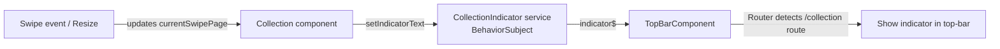

# Plan: Move Collection Indicator Text into Top Bar

## Goal

Move the swipe indicator text "1-9 из 64" from its current standalone position above the card carousel into the **top-right corner of the global top-bar** (`<app-top-bar>`), and set the gap between the top-bar and the cards to **5px**.

## Current State

- **Top-bar** (`src/app/components/top-bar/`): A global fixed component displayed on all pages. Currently shows only "Карта дня" title.
- **Swipe indicator** (`collection.html:4-6`): A standalone `<div class="swipe-indicator">` showing `{{ currentRangeStart }}-{{ currentRangeEnd }} из {{ totalCardsCount }}`.
- **Collection page** uses `Router` for navigation; top-bar is a sibling of `<router-outlet>` in `app.html`.

## Architecture Decision

Since the top-bar is a **global component** and the indicator text is **dynamic** (changes on swipe), we need a communication mechanism between the `Collection` page component and the `TopBarComponent`.

**Approach: Shared Service with RxJS Subject**

Create a lightweight `CollectionIndicatorService` that:
- Exposes a `BehaviorSubject<string>` for the current indicator text
- The `Collection` component pushes updates via `setIndicatorText(text)`
- The `TopBarComponent` subscribes and displays the text when on the `/collection` route

This is cleaner than using `@Output`/`@Input` (which don't work across sibling components via `<router-outlet>`) or complex state management.

## Changes Required

### 1. Create `src/app/services/collection-indicator.ts`

A new service:

```typescript
import { Injectable } from '@angular/core';
import { BehaviorSubject } from 'rxjs';

@Injectable({ providedIn: 'root' })
export class CollectionIndicator {
  private indicatorSource = new BehaviorSubject<string>('');
  indicator$ = this.indicatorSource.asObservable();

  setIndicatorText(text: string): void {
    this.indicatorSource.next(text);
  }
}
```

### 2. Update `src/app/components/top-bar/top-bar.ts`

- Inject `Router` (to detect current route) and `CollectionIndicator` service
- Subscribe to `indicator$` to get the current text
- Use `Router.events` (filtered to `NavigationEnd`) to detect if we're on `/collection`
- Expose `showIndicator` and `indicatorText` properties to the template

### 3. Update `src/app/components/top-bar/top-bar.html`

Add the indicator text inside the `.top-bar` div, positioned to the right:

```html
<div class="top-bar">
  <div class="top-bar-title">Карта дня</div>
  <span class="collection-indicator" *ngIf="showIndicator">{{ indicatorText }}</span>
</div>
```

### 4. Update `src/app/components/top-bar/top-bar.scss`

Style the `.collection-indicator` to appear in the top-right corner of the top-bar:

```scss
.collection-indicator {
  position: absolute;
  top: env(safe-area-inset-top, 0px);
  right: 16px;
  font-size: 13px;
  font-weight: 500;
  color: rgba(60, 60, 67, 0.6);
  user-select: none;
  line-height: calc(env(safe-area-inset-top, 0px) + 44px); // vertically centered in top-bar
}
```

Also adjust `.top-bar` to have `position: relative` (if not already) so the absolute positioning works correctly.

### 5. Update `src/app/pages/collection/collection.ts`

- Inject `CollectionIndicator` service
- After `buildSwipePages()` or whenever the range changes, call:
  ```typescript
  this.collectionIndicator.setIndicatorText(`${this.currentRangeStart}-${this.currentRangeEnd} из ${this.totalCardsCount}`);
  ```
- Update in `ngOnInit()`, `onResize()`, and `onTouchEnd()` (where `currentSwipePage` changes)

### 6. Update `src/app/pages/collection/collection.html`

Remove the standalone `.swipe-indicator` div (lines 4-6):

```diff
-    <!-- Swipe indicator (mobile) -->
-    <div class="swipe-indicator" *ngIf="!showDetail && swipePages.length > 0">
-      {{ currentRangeStart }}-{{ currentRangeEnd }} из {{ totalCardsCount }}
-    </div>
```

### 7. Update `src/app/pages/collection/collection.scss`

- Remove or hide the `.swipe-indicator` styles (lines 24-33) — they're no longer needed in collection.scss
- Set the gap between the top-bar and the swipe container to **5px** by adjusting the `.swipe-container` margin-top or the `.collection-container` padding-top

The current `padding-top` on `.collection-container` is `calc(env(safe-area-inset-top, 0px) + 60px)` (line 10). The top-bar height is `calc(env(safe-area-inset-top, 0px) + 44px)`. So the current gap is `60 - 44 = 16px`. We need to change this to 5px gap, so `padding-top` should be `calc(env(safe-area-inset-top, 0px) + 44px + 5px)` = `calc(env(safe-area-inset-top, 0px) + 49px)`.

Similarly for mobile breakpoints:
- At `max-width: 768px`: top-bar height = `calc(env(safe-area-inset-top, 0px) + 40px)`, current padding-top = `calc(env(safe-area-inset-top, 0px) + 55px)`, gap = 15px → new padding-top = `calc(env(safe-area-inset-top, 0px) + 45px)`
- At `max-width: 480px`: top-bar height = `calc(env(safe-area-inset-top, 0px) + 36px)`, current padding-top = `calc(env(safe-area-inset-top, 0px) + 50px)`, gap = 14px → new padding-top = `calc(env(safe-area-inset-top, 0px) + 41px)`

## Files to Modify

| File | Action |
|------|--------|
| `src/app/services/collection-indicator.ts` | **Create** new service |
| `src/app/components/top-bar/top-bar.ts` | **Modify** — inject Router + CollectionIndicator, subscribe |
| `src/app/components/top-bar/top-bar.html` | **Modify** — add indicator span |
| `src/app/components/top-bar/top-bar.scss` | **Modify** — add indicator styles |
| `src/app/pages/collection/collection.ts` | **Modify** — inject CollectionIndicator, push updates |
| `src/app/pages/collection/collection.html` | **Modify** — remove swipe-indicator div |
| `src/app/pages/collection/collection.scss` | **Modify** — remove indicator styles, adjust padding-top to 5px gap |

## Diagram: Data Flow



## Verification

1. Navigate to `/collection` — the top-bar should show "1-9 из 64" (or similar) in the top-left corner
2. Swipe left/right — the numbers should update correctly
3. Resize the window — the numbers should update
4. Navigate to other pages (`/prediction`, `/question`) — the indicator should NOT appear in the top-bar
5. The gap between the top-bar and the first row of cards should be exactly 5px
