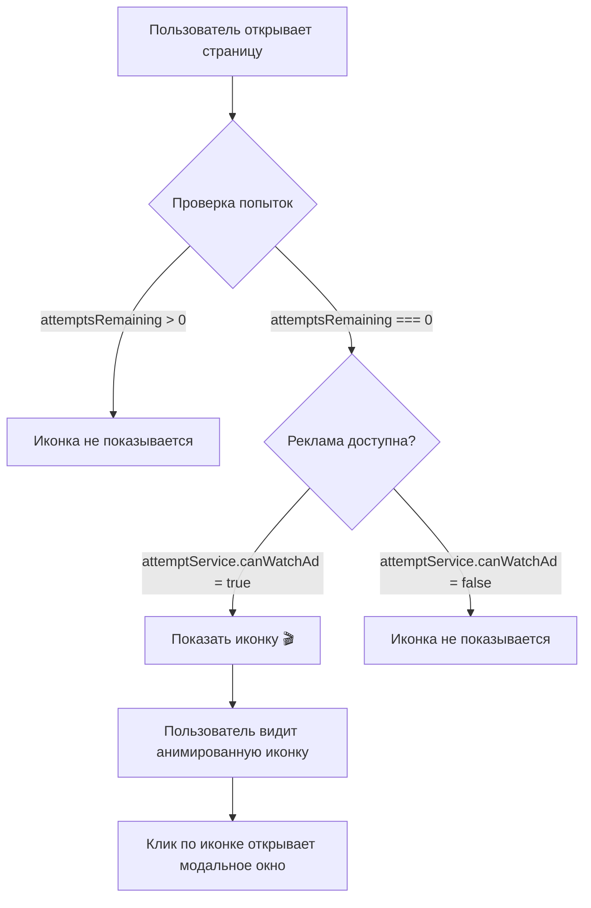

# Финальный план реализации значка рекламы

## Обзор задачи
Добавить значок рекламы 🎬 в счетчик попыток предсказаний, чтобы пользователь заметил возможность получить дополнительную попытку через просмотр рекламы.

## Логика отображения



## Детали реализации

### 1. HTML изменения
**Файл:** `src/app/pages/prediction/prediction.html`
```html
<!-- Текущая версия -->
<div class="attempts">
  Осталось попыток: <span class="attempt-count">{{ attemptsRemaining }}</span>
</div>

<!-- Новая версия -->
<div class="attempts">
  Осталось попыток: <span class="attempt-count">{{ attemptsRemaining }}</span>
  <span class="ad-icon" 
        *ngIf="attemptsRemaining === 0 && attemptService.canWatchAd()"
        title="Получить ещё попытку через просмотр рекламы"
        (click)="showAdModal = true">
    🎬
  </span>
</div>
```

### 2. CSS/SCSS изменения
**Файл:** `src/app/pages/prediction/prediction.scss`

Добавить в секцию `.controls`:
```scss
.attempts {
  font-size: 1.3rem;
  margin-bottom: 10px;
  display: flex;
  align-items: center;
  justify-content: center;
  gap: 10px;

  .attempt-count {
    font-weight: bold;
    color: #00ffaa;
    font-size: 1.8rem;
  }

  .ad-icon {
    display: inline-block;
    margin-left: 10px;
    font-size: 1.5rem;
    cursor: pointer;
    animation: pulse 2s infinite;
    vertical-align: middle;
    transition: transform 0.3s;
    
    &:hover {
      transform: scale(1.2);
      color: #ffcc00;
    }
  }
}

@keyframes pulse {
  0% {
    opacity: 0.7;
    transform: scale(1);
  }
  50% {
    opacity: 1;
    transform: scale(1.1);
  }
  100% {
    opacity: 0.7;
    transform: scale(1);
  }
}
```

### 3. Адаптивные стили
Добавить в медиа-запросы:
```scss
@media (max-width: 480px) {
  .attempts {
    font-size: 1rem;
    
    .attempt-count {
      font-size: 1.5rem;
    }
    
    .ad-icon {
      font-size: 1.3rem;
      margin-left: 8px;
    }
  }
}
```

## Тестовые сценарии

| Сценарий | Ожидаемый результат |
|----------|-------------------|
| Попытки > 0 | Иконка не отображается |
| Попытки = 0, реклама доступна | Иконка 🎬 отображается с анимацией |
| Попытки = 0, реклама просмотрена | Иконка не отображается |
| Клик по иконке | Открывается модальное окно с рекламой |
| Наведение на иконку | Показывается тултип "Получить ещё попытку через просмотр рекламы" |

## Преимущества решения

1. **Повышение заметности** - Анимированная иконка привлекает внимание пользователя
2. **Интуитивная понятность** - Иконка 🎬 ассоциируется с видео/рекламой
3. **Улучшение UX** - Пользователь сразу видит возможность получить дополнительную попытку
4. **Минимальные изменения** - Не требуется изменения бизнес-логики
5. **Адаптивность** - Работает на всех размерах экранов

## Альтернативные варианты

1. **Иконка с текстом** - Можно добавить текст "Реклама" рядом с иконкой
2. **Разные иконки** - 📺 (телевизор), 🎥 (кинокамера), 📱 (смартфон)
3. **Кнопка вместо иконки** - Сделать полноценную кнопку "Получить попытку"

## Рекомендации по реализации

1. **Приоритет:** Высокий - улучшает пользовательский опыт
2. **Сложность:** Низкая - только фронтенд изменения
3. **Время:** 1-2 часа на реализацию и тестирование
4. **Риски:** Минимальные - не затрагивает критическую функциональность

## Следующие шаги

1. Переключиться в режим Code для реализации
2. Внести изменения в HTML и SCSS файлы
3. Протестировать все сценарии
4. Проверить адаптивность на разных устройствах
5. Обновить документацию при необходимости
