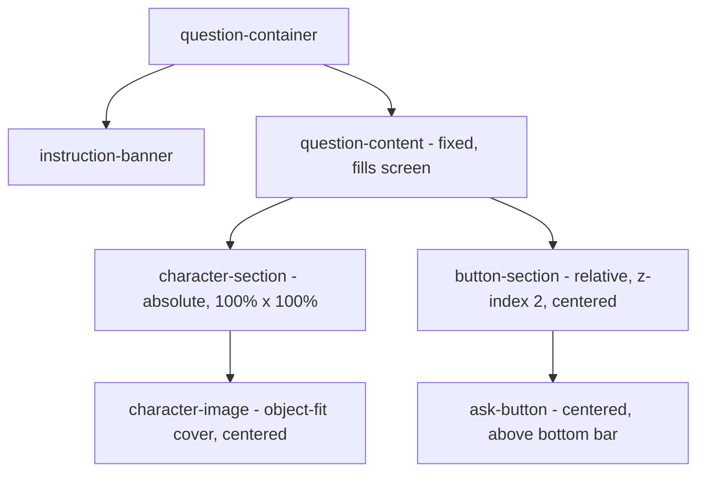

# План: Адаптация страницы Оракула под мобильные устройства

## Проблема

1. **Изображение `cold.png`** расположено с `position: absolute; right: 130px`, прибито к правому краю с большим отступом. На мобильных устройствах это приводит к неправильному обрезанию и позиционированию персонажа.
2. **Кнопка "Спросить"** находится слева в отдельной секции (`.button-section`), а не поверх персонажа.

## Цель

1. Изображение персонажа (`cold.png`) должно быть **по центру экрана**, занимать всю доступную ширину и высоту, с `object-fit: cover`, чтобы персонаж был по центру на любых мобильных устройствах.
2. Кнопка "Спросить" должна быть **поверх персонажа, по центру внизу**, с небольшим отступом над нижней плашкой (bottom bar) в стиле iPhone.

---

## План изменений

### Файл: `src/app/pages/question/question.scss`

#### 1. `.question-content` — контейнер

Текущий:
```scss
.question-content {
  position: fixed;
  left: 0;
  right: 0;
  bottom: 0;
  top: 0;
  display: flex;
  flex-direction: row;
  align-items: flex-end;
  pointer-events: none;
  z-index: 1;
}
```

Новый:
```scss
.question-content {
  position: fixed;
  left: 0;
  right: 0;
  bottom: 0;
  top: 0;
  display: flex;
  flex-direction: column;
  align-items: center;
  justify-content: flex-end;
  pointer-events: none;
  z-index: 1;
}
```

**Изменения:**
- `flex-direction: row` → `column` (вертикальное расположение)
- Удалён `align-items: flex-end` → добавлен `align-items: center` (центрирование по горизонтали)
- `justify-content: flex-end` (прижимаем контент к низу)

#### 2. `.character-section` — контейнер изображения

Текущий:
```scss
.character-section {
  position: absolute;
  right: 130px;
  bottom: 0;
  width: 82%;
  height: 88vh;
  pointer-events: none;
}
```

Новый:
```scss
.character-section {
  position: absolute;
  left: 0;
  right: 0;
  top: 0;
  bottom: 0;
  width: 100%;
  height: 100%;
  pointer-events: none;
  overflow: hidden;
}
```

**Изменения:**
- Вместо `right: 130px; width: 82%; height: 88vh` → `left: 0; right: 0; top: 0; bottom: 0; width: 100%; height: 100%`
- Добавлен `overflow: hidden` для предотвращения выхода изображения за пределы

#### 3. `.character-image` — само изображение

Текущий:
```scss
.character-image {
  display: block;
  width: 182%;
  height: 106%;
  object-fit: contain;
  object-position: bottom right;
  pointer-events: auto;
  margin-bottom: calc(-15px - env(safe-area-inset-bottom, 0px));
}
```

Новый:
```scss
.character-image {
  display: block;
  width: 100%;
  height: 100%;
  object-fit: cover;
  object-position: center center;
  pointer-events: auto;
}
```

**Изменения:**
- `width: 182%` → `width: 100%`
- `height: 106%` → `height: 100%`
- `object-fit: contain` → `object-fit: cover` (заполняет весь контейнер, обрезая края)
- `object-position: bottom right` → `object-position: center center` (центрирование персонажа)
- Удалён `margin-bottom: calc(-15px - ...)` (больше не нужно вытягивать вниз)

#### 4. `.button-section` — контейнер кнопки

Текущий:
```scss
.button-section {
  flex: 0 0 28%;
  max-width: 28%;
  display: flex;
  align-items: flex-end;
  justify-content: center;
  height: 100%;
  pointer-events: auto;
  padding-bottom: calc(70px + env(safe-area-inset-bottom, 0px) + 40px);
  padding-left: 16px;
  box-sizing: border-box;
}
```

Новый:
```scss
.button-section {
  position: relative;
  z-index: 2;
  display: flex;
  align-items: center;
  justify-content: center;
  pointer-events: auto;
  padding-bottom: calc(70px + env(safe-area-inset-bottom, 0px) + 16px);
  box-sizing: border-box;
  width: 100%;
}
```

**Изменения:**
- Удалён `flex: 0 0 28%; max-width: 28%; height: 100%`
- Добавлен `position: relative; z-index: 2` (поверх изображения)
- `padding-bottom` уменьшен с `+40px` до `+16px` (небольшой отступ над bottom bar)
- Удалён `padding-left: 16px` (центрирование через flex)
- Добавлен `width: 100%`

#### 5. Медиа-запросы — упрощение

В медиа-запросах для `.button-section` и `.ask-button` нужно убрать лишние обёртки и padding-left, оставив только изменение размера кнопки и отступа снизу.

**Для `@media (max-width: 768px)`:**
```scss
.button-section {
  padding-bottom: calc(70px + env(safe-area-inset-bottom, 0px) + 12px);
}
```

**Для `@media (max-width: 480px)`:**
```scss
.button-section {
  padding-bottom: calc(70px + env(safe-area-inset-bottom, 0px) + 8px);
}
```

---

### Файл: `src/app/pages/question/question.html`

HTML-структура остаётся без изменений. Меняется только CSS.

---

## Визуальная схема



## Итоговый вид

```
┌──────────────────────────┐
│     instruction-banner    │  ← вверху, как сейчас
│                          │
│                          │
│     ┌────────────┐       │
│     │            │       │
│     │  персонаж  │       │  ← cold.png, cover, по центру
│     │  (center)  │       │
│     │            │       │
│     └────────────┘       │
│                          │
│       [Спросить]         │  ← кнопка по центру внизу
│                          │     поверх изображения
│  ┌────────────────────┐  │
│  │   bottom bar       │  │  ← отступ 16px над bottom bar
│  └────────────────────┘  │
└──────────────────────────┘
