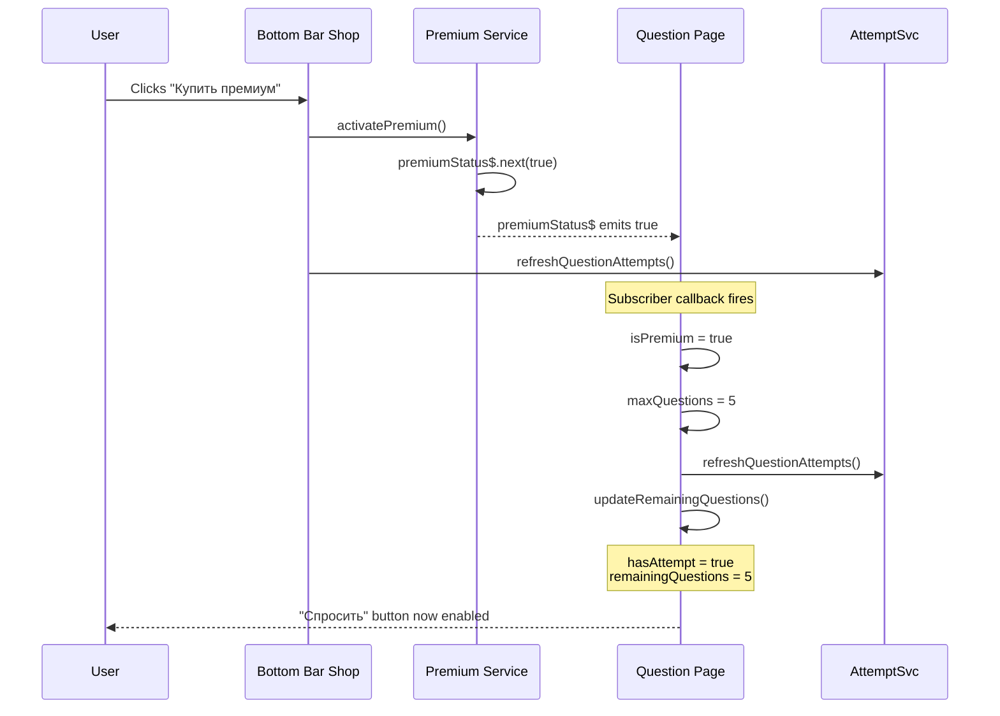

# Oracle Page: Reactive Premium Purchase Refresh

## Problem

When a user is on the `/question` (oracle) page and purchases premium from the bottom-bar shop modal, the question page does not reactively update. The `isPremium` and `hasAttempt` flags remain stale because they are only set once in `ngOnInit()`.

This means:
- The "Спросить" button remains disabled (because `hasAttempt` is still `false` for non-premium users who used their 1 free question)
- The user has to manually navigate away and back to see the updated state

## Root Cause

The [`Question`](src/app/pages/question/question.ts:13) component does not subscribe to any reactive observable for premium or attempt changes. Compare with:

- [`Prediction`](src/app/pages/prediction/prediction.ts:37) subscribes to `attemptService.attemptsChanged$`
- [`Collection`](src/app/pages/collection/collection.ts:61) subscribes to `premium.premiumStatus$`

## Solution

Make the `Question` component implement `OnDestroy` and subscribe to the `Premium.premiumStatus$` observable to reactively update its state when premium is purchased.

### Changes to [`src/app/pages/question/question.ts`](src/app/pages/question/question.ts)

1. **Add `OnDestroy` import** from `@angular/core`
2. **Add `Subscription` import** from `rxjs`
3. **Add `OnDestroy` to the class implements clause**
4. **Add a `private premiumSubscription: Subscription | null = null`** field
5. **In `ngOnInit()`**, subscribe to `this.premium.premiumStatus$`:
   - When premium becomes `true`:
     - Set `this.isPremium = true`
     - Set `this.maxQuestions = 5`
     - Call `this.attempt.refreshQuestionAttempts()` to grant 5 attempts
     - Call `this.updateRemainingQuestions()` to refresh `hasAttempt` and `remainingQuestions`
   - When premium becomes `false` (edge case): reset to non-premium state
6. **Add `ngOnDestroy()`** method that unsubscribes from `premiumSubscription`

### Why subscribe to `premiumStatus$` instead of `attemptsChanged$`?

- `premiumStatus$` is the direct signal that premium was purchased
- Subscribing to `premiumStatus$` allows us to also update `isPremium` and `maxQuestions`, not just `hasAttempt`
- The `Attempt.refreshQuestionAttempts()` is already called by the bottom-bar's `purchasePremium()`, but the question page doesn't know about it — subscribing to `premiumStatus$` lets us react and call `updateRemainingQuestions()` to refresh the local state from localStorage

### Flow Diagram

### Edge Cases Covered

1. **User is already premium**: `premiumStatus$` emits `true` on subscribe if already premium — handled by checking `isPremium` before calling `refreshQuestionAttempts` (or just calling it anyway, since it's idempotent)
2. **User purchases premium from question page's own button**: The existing `purchasePremium()` method already handles this, but the subscription will also fire — this is fine since `refreshQuestionAttempts` is idempotent
3. **Component destroyed**: Properly unsubscribed in `ngOnDestroy()` to prevent memory leaks
4. **Premium deactivated** (testing/refund): `premiumStatus$` emits `false` — reset to non-premium state
