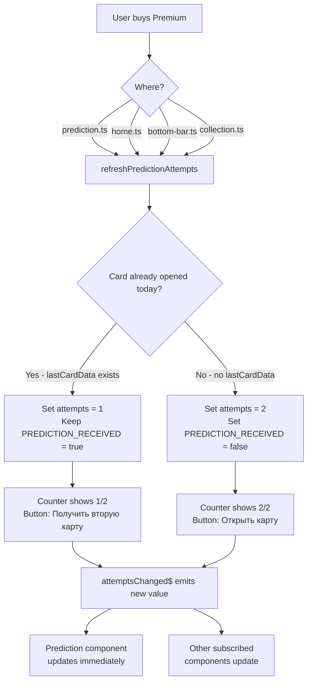

# Premium Attempt Counter Fix Plan

## Problem Analysis

### Bug: Counter shows 2/2 instead of 1/2 after premium purchase with opened card

When a user opens 1 card (non-premium, 0/1 remaining) and then purchases premium, the attempt counter should show **1/2** (1 used, 1 remaining). Currently it shows **2/2**.

### Root Cause

Premium can be purchased from **4 different places** in the app:

| Purchase Location | File | Current Behavior |
|---|---|---|
| Prediction page | [`prediction.ts`](../src/app/pages/prediction/prediction.ts:208) | ✅ Correctly handles "already opened card" case via `setAttempts(1)` |
| Home page | [`home.ts`](../src/app/pages/home/home.ts:25) | ❌ Calls `refreshPredictionAttempts()` → sets attempts to 2 unconditionally |
| Bottom bar (shop modal) | [`bottom-bar.ts`](../src/app/components/bottom-bar/bottom-bar.ts:111) | ❌ Calls `refreshPredictionAttempts()` → sets attempts to 2 unconditionally |
| Collection page | [`collection.ts`](../src/app/pages/collection/collection.ts:169) | ❌ Doesn't touch prediction attempts at all |

The method [`refreshPredictionAttempts()`](../src/app/services/attempt.ts:106) unconditionally sets attempts to **2** and resets `PREDICTION_RECEIVED_KEY` to `'false'`. When the user buys premium from home/bottom-bar and then navigates to the prediction page, `ngOnInit()` reads the value of 2 from localStorage — showing 2/2.

### Second Issue: Counter doesn't update immediately

When premium is purchased from **home page** or **bottom bar**, the prediction page is not notified. The user has to navigate to the prediction page to see the updated counter. The counter should update **immediately** after purchase.

## Solution Design

### Core Principle

The `Attempt` service should be the single source of truth. It should provide a method that correctly calculates remaining attempts after premium purchase, considering whether a card was already opened today.

### Changes Required

#### 1. [`attempt.ts`](../src/app/services/attempt.ts) — Add smart refresh method

Replace the current `refreshPredictionAttempts()` with a smarter version that checks if a card was already opened today:

```typescript
/**
 * Refresh prediction attempts after premium purchase.
 * - If a card was already opened today → set attempts to 1 (1 used, 1 remaining)
 * - If no card was opened today → set attempts to 2 (full premium allowance)
 */
refreshPredictionAttempts(): void {
    const today = new Date().toDateString();
    localStorage.setItem(this.LAST_RESET_KEY, today);
    
    // Check if a card was already opened today
    const lastCardData = this.getLastCardData();
    if (lastCardData) {
        // Card was already opened → 1 used, 1 remaining
        localStorage.setItem(this.STORAGE_KEY, '1');
        // Keep PREDICTION_RECEIVED_KEY as true since card was already received
        localStorage.setItem(this.PREDICTION_RECEIVED_KEY, 'true');
    } else {
        // No card opened → full 2 attempts available
        localStorage.setItem(this.STORAGE_KEY, '2');
        localStorage.setItem(this.PREDICTION_RECEIVED_KEY, 'false');
    }
}
```

#### 2. [`prediction.ts`](../src/app/pages/prediction/prediction.ts) — Simplify `purchasePremium()`

Remove the redundant `setAttempts(1)` logic since `refreshPredictionAttempts()` now handles it:

```typescript
purchasePremium(): void {
    this.premium.activatePremium();
    this.isPremium = true;
    this.maxAttemptsPerDay = 2;
    // refreshPredictionAttempts now smartly handles the "already opened card" case
    this.attemptService.refreshPredictionAttempts();
    this.updateAttempts();
    this.attemptService.refreshQuestionAttempts();

    if (!this.showCardFace) {
        // No card opened — load fresh card with back showing
        this.loadRandomCard(false);
        this.showCardFace = false;
        this.showPrediction = false;
    }
    // If card is already open, just keep it — counter now shows correct value
}
```

#### 3. [`home.ts`](../src/app/pages/home/home.ts) — Add immediate counter update

The home page should notify the prediction page that attempts have changed. Since these are separate components, we need a shared event mechanism. The simplest approach is to use the `Attempt` service with a `BehaviorSubject` that components can subscribe to.

Add to [`attempt.ts`](../src/app/services/attempt.ts):
```typescript
import { Injectable } from '@angular/core';
import { BehaviorSubject } from 'rxjs';

// Add a reactive subject
private attemptsChangedSource = new BehaviorSubject<number>(this.getRemainingAttempts());
attemptsChanged$ = this.attemptsChangedSource.asObservable();

// Call this after any attempt modification
private notifyAttemptsChanged(): void {
    this.attemptsChangedSource.next(this.getRemainingAttempts());
}
```

Then in [`prediction.ts`](../src/app/pages/prediction/prediction.ts), subscribe to this observable to update the counter reactively.

#### 4. [`bottom-bar.ts`](../src/app/components/bottom-bar/bottom-bar.ts) — Same fix

The `purchasePremium()` method here also needs to use the updated `refreshPredictionAttempts()`.

#### 5. [`collection.ts`](../src/app/pages/collection/collection.ts) — Add prediction attempt refresh

The `purchasePremium()` method here should also call `refreshPredictionAttempts()`.

## Detailed Implementation Steps

### Step 1: Update `attempt.ts` service

1. Add `BehaviorSubject` import from `rxjs`
2. Add `attemptsChanged$` observable
3. Modify `refreshPredictionAttempts()` to check `getLastCardData()`
4. Add `notifyAttemptsChanged()` calls in `useAttempt()`, `setAttempts()`, `refreshPredictionAttempts()`

### Step 2: Update `prediction.ts` component

1. Subscribe to `attemptService.attemptsChanged$` in `ngOnInit()`
2. Unsubscribe in `ngOnDestroy()`
3. Simplify `purchasePremium()` — remove manual `setAttempts(1)` logic

### Step 3: Update `home.ts` component

No changes needed to the purchase flow itself — `refreshPredictionAttempts()` now handles the logic correctly. The reactive subscription in prediction.ts will handle the immediate update.

### Step 4: Update `bottom-bar.ts` component

No changes needed — same reasoning as home.ts.

### Step 5: Update `collection.ts` component

Add `this.attempt.refreshPredictionAttempts()` call in `purchasePremium()`.

## Verification Scenarios

| # | Scenario | Expected Counter | Expected Button |
|---|---|---|---|
| 1 | Non-premium, no card opened → buy premium from prediction page | 2/2 | "Открыть карту" |
| 2 | Non-premium, 1 card opened → buy premium from prediction page | 1/2 | "Получить вторую карту" |
| 3 | Non-premium, no card opened → buy premium from home page → navigate to prediction | 2/2 | "Открыть карту" |
| 4 | Non-premium, 1 card opened → buy premium from home page → navigate to prediction | 1/2 | "Получить вторую карту" |
| 5 | Non-premium, no card opened → buy premium from bottom bar → navigate to prediction | 2/2 | "Открыть карту" |
| 6 | Non-premium, 1 card opened → buy premium from bottom bar → navigate to prediction | 1/2 | "Получить вторую карту" |
| 7 | Non-premium, no card opened → buy premium from collection → navigate to prediction | 2/2 | "Открыть карту" |
| 8 | Non-premium, 1 card opened → buy premium from collection → navigate to prediction | 1/2 | "Получить вторую карту" |
| 9 | Premium user, 0 cards opened today → normal flow | 2/2 | "Открыть карту" |
| 10 | Premium user, 1 card opened → normal flow | 1/2 | "Получить вторую карту" |
| 11 | Premium user, 2 cards opened → normal flow | 0/2 | Timer shown |
| 12 | Non-premium user (no changes) | 1/1 or 0/1 | Normal behavior |

## Architecture Diagram



## Files to Modify

1. [`src/app/services/attempt.ts`](../src/app/services/attempt.ts) — Core fix: smart `refreshPredictionAttempts()`, add reactive observable
2. [`src/app/pages/prediction/prediction.ts`](../src/app/pages/prediction/prediction.ts) — Subscribe to reactive updates, simplify `purchasePremium()`
3. [`src/app/pages/home/home.ts`](../src/app/pages/home/home.ts) — No changes needed (service handles logic)
4. [`src/app/components/bottom-bar/bottom-bar.ts`](../src/app/components/bottom-bar/bottom-bar.ts) — No changes needed (service handles logic)
5. [`src/app/pages/collection/collection.ts`](../src/app/pages/collection/collection.ts) — Add `refreshPredictionAttempts()` call
