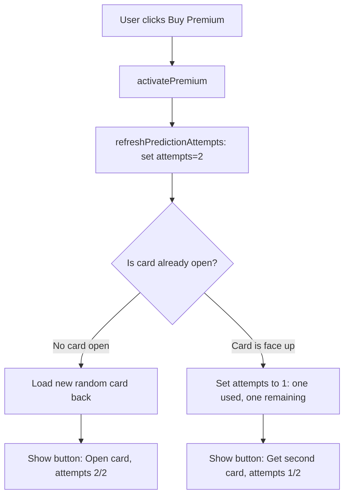
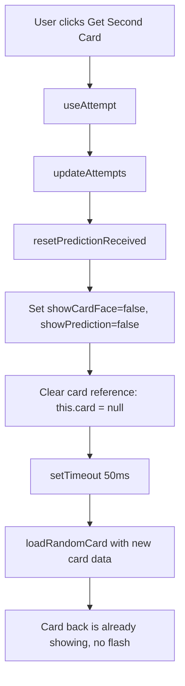

# Premium Purchase Flow & Card Flash Fix Plan

## Problem Analysis

### Problem 1: Premium purchase resets card state incorrectly

**Current behavior in [`purchasePremium()`](src/app/pages/prediction/prediction.ts:200):**
```typescript
purchasePremium(): void {
    this.premium.activatePremium();
    this.isPremium = true;
    this.maxAttemptsPerDay = 2;
    this.attemptService.refreshPredictionAttempts();
    this.updateAttempts();
    this.attemptService.refreshQuestionAttempts();
    // ❌ Always resets card state regardless of whether user already opened a card
    this.loadRandomCard(false);
    this.showCardFace = false;
    this.showPrediction = false;
}
```

**Scenarios that break:**

| Scenario | Current Behavior | Expected Behavior |
|----------|-----------------|-------------------|
| User enters app, doesn't open card, buys premium | Card resets to new random card (back), attempts = 2/2 ✅ | Same — correct |
| User opens 1 card (face up), buys premium | Card is **replaced** with a new random card, user loses the card they already opened ❌ | Keep the already-opened card face up, show attempts = 1/2, button says "Получить вторую карту" |

### Problem 2: Card image flashes when clicking "Получить вторую карту"

**Current flow in [`drawNewCard()`](src/app/pages/prediction/prediction.ts:180):**
```typescript
drawNewCard(): void {
    if (this.attemptsRemaining > 0) {
        const used = this.attemptService.useAttempt();
        if (used) {
            this.updateAttempts();
            this.attemptService.resetPredictionReceived();
            this.loadRandomCard(true, true);  // ← Sets this.card to new card WITH imageUrl
            this.showCardFace = false;          // ← Hides face, shows back
            this.showPrediction = false;
        }
    }
}
```

**Root cause:** `loadRandomCard()` sets `this.card` to a new card object that has `imageUrl` already populated. Angular's change detection immediately updates the DOM binding `[style.backgroundImage]="'url(' + card?.imageUrl + ')'"`. Even though `showCardFace` is set to `false` right after, there's a brief moment where:
1. The new card's image starts loading in the background
2. The `.face` div has `opacity: 0` and `pointer-events: none` (via `.visible` class), but the `background-image` CSS property is still set
3. The browser may start fetching the image before the opacity transition hides it

The `.back` side has `z-index: 2` and `.face` has `z-index: 1`, so the back should be on top. But if the image loads and the browser repaints before the CSS transition completes, there can be a flash.

### Problem 3: Premium notice text should be removed

The `<div class="premium-notice">` in [`prediction.html:48`](src/app/pages/prediction/prediction.html:48) says "Премиум пользователь получает 2 карты в день" and needs to be removed.

---

## Solution Plan

### Fix 1: Smart premium purchase flow

Modify [`purchasePremium()`](src/app/pages/prediction/prediction.ts:200) to handle both scenarios:

```typescript
purchasePremium(): void {
    this.premium.activatePremium();
    this.isPremium = true;
    this.maxAttemptsPerDay = 2;
    
    // Grant full attempts
    this.attemptService.refreshPredictionAttempts();
    this.updateAttempts();
    this.attemptService.refreshQuestionAttempts();
    
    // Check if user already has a card opened (face up)
    if (this.showCardFace) {
        // Card is already open — keep it, just update attempts
        // attemptsRemaining is now 2, but user used 1 attempt already
        // We need to set attempts to 2 minus the already-used attempt
        // Actually, refreshPredictionAttempts sets to 2, and updateAttempts reads it
        // But the user already used 1 attempt to open the current card
        // So we should set attempts to 1 (2 total - 1 used)
        // OR: we set to 2 and let the user have 2 more (total 3) — but max is 2
        // Correct approach: set attempts to 2, but mark that 1 was used
        // Simpler: just set to 1 (remaining) since 1 was already used
        this.attemptService.setAttempts(1);
        this.updateAttempts();
        // Button will show "Получить вторую карту"
        // Attempts counter shows 1/2
    } else {
        // No card opened — load fresh card with back showing
        this.loadRandomCard(false);
        this.showCardFace = false;
        this.showPrediction = false;
        // attemptsRemaining is already 2 from refreshPredictionAttempts
    }
}
```

This requires adding a `setAttempts(n)` method to the [`Attempt`](src/app/services/attempt.ts) service.

### Fix 2: Prevent card image flash on "Получить вторую карту"

**Approach:** Delay setting the card's image URL until AFTER the back side is fully shown. Use a two-step process:

1. First set `showCardFace = false` and `showPrediction = false` (show back)
2. Then load the new card data
3. Use `setTimeout(0)` or `requestAnimationFrame` to ensure the back is rendered before the new card image is set

Modified [`drawNewCard()`](src/app/pages/prediction/prediction.ts:180):

```typescript
drawNewCard(): void {
    if (this.attemptsRemaining > 0) {
        const used = this.attemptService.useAttempt();
        if (used) {
            this.updateAttempts();
            this.attemptService.resetPredictionReceived();
            
            // Step 1: Immediately hide the face to show back
            this.showCardFace = false;
            this.showPrediction = false;
            
            // Step 2: Clear the current card image to prevent flash
            const newCard = this.cardData.getNewCard(this.attemptService.getCollection());
            const newPrediction = this.previousPredictionId !== null 
                ? this.cardData.getDifferentPrediction(this.previousPredictionId)
                : this.cardData.getRandomPrediction();
            
            // Step 3: Use setTimeout to ensure back is rendered before setting new card
            setTimeout(() => {
                this.card = newCard;
                this.prediction = newPrediction;
                if (this.prediction) {
                    this.previousPredictionId = this.prediction.id;
                }
                // Add to collection
                if (this.card && !this.attemptService.hasCard(this.card.id)) {
                    this.attemptService.addCardToCollection(this.card.id);
                }
            }, 50); // Small delay to ensure back is rendered
        }
    }
}
```

**Alternative simpler approach:** Set `card` to `null` first, then set it after a tick:

```typescript
// Clear card to prevent any image loading
this.card = null;
this.showCardFace = false;
this.showPrediction = false;

// Use setTimeout to defer card assignment
setTimeout(() => {
    this.loadRandomCard(true, true);
}, 50);
```

### Fix 3: Remove premium notice

Remove the entire `<div class="premium-notice">` block from [`prediction.html`](src/app/pages/prediction/prediction.html:48-50).

Also remove the corresponding CSS for `.premium-notice` in [`prediction.scss`](src/app/pages/prediction/prediction.scss:303-315) and all its responsive variants.

---

## Files to Modify

| File | Changes |
|------|---------|
| [`src/app/services/attempt.ts`](src/app/services/attempt.ts) | Add `setAttempts(n: number)` method |
| [`src/app/pages/prediction/prediction.ts`](src/app/pages/prediction/prediction.ts) | Fix `purchasePremium()` logic; fix `drawNewCard()` flash |
| [`src/app/pages/prediction/prediction.html`](src/app/pages/prediction/prediction.html) | Remove premium notice div |
| [`src/app/pages/prediction/prediction.scss`](src/app/pages/prediction/prediction.scss) | Remove `.premium-notice` CSS |

---

## Detailed Changes

### Change 1: Add `setAttempts()` to Attempt service

In [`attempt.ts`](src/app/services/attempt.ts), add after line 66 (`useAttempt`):

```typescript
setAttempts(count: number): void {
    const maxAttempts = this.premium.isPremium() ? 2 : 1;
    const cappedCount = Math.min(count, maxAttempts);
    localStorage.setItem(this.STORAGE_KEY, cappedCount.toString());
}
```

### Change 2: Fix `purchasePremium()` in prediction.ts

Replace the current implementation with smart logic that checks `showCardFace`.

### Change 3: Fix `drawNewCard()` in prediction.ts

Add a small delay or clear the card before setting the new one to prevent image flash.

### Change 4: Remove premium notice from HTML

Delete lines 47-50 from `prediction.html`.

### Change 5: Remove premium notice CSS

Delete `.premium-notice` block (lines 303-315) and all responsive variants from `prediction.scss`.

---

## Mermaid Diagram: Premium Purchase Flow



## Mermaid Diagram: Draw New Card Flow (Flash Fix)



---

## Testing Checklist

1. **Scenario: No card opened → Buy premium**
   - Enter prediction page
   - Click "Купить премиум" (button shows when attempts = 0)
   - Verify: card back shows, button says "Открыть карту", attempts = 2/2

2. **Scenario: Card opened → Buy premium**
   - Open a card (flip it)
   - Click "Купить премиум"
   - Verify: card stays face up, button says "Получить вторую карту", attempts = 1/2

3. **Scenario: Get second card — no flash**
   - Open first card
   - Click "Получить вторую карту"
   - Verify: card back shows immediately, no image flash, then click to reveal new card

4. **Scenario: Premium notice removed**
   - Verify: no "Премиум пользователь получает 2 карты в день" text anywhere
