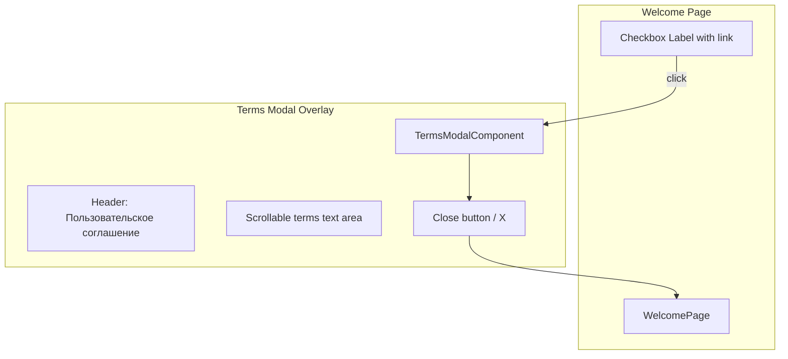
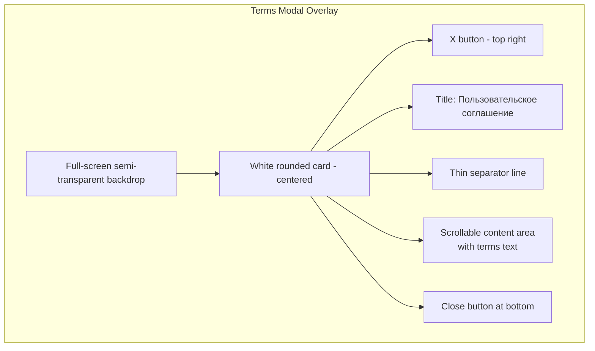

# Clickable "User Agreement" Link with In-App WebView — Implementation Plan

## Overview

Make the text "Пользовательским соглашением" in the welcome page checkbox label a clickable link. When tapped, it opens an in-app modal/overlay (WebView-style) displaying the terms text. The solution should support adding a remote URL later, but for now use embedded placeholder text.

---

## Current State

In [`src/app/pages/welcome/welcome.html:36-38`](src/app/pages/welcome/welcome.html:36-38), the checkbox label contains plain text:

```html
<span class="checkbox-label">
  Я заявляю, что мне исполнилось 18 лет, я согласен с Пользовательским
  соглашением и понимаю развлекательный характер приложения.
</span>
```

The word "Пользовательским соглашением" is not clickable — it's just plain text.

---

## Proposed Solution

### Architecture

```mermaid
flowchart TD
    A[User taps "Пользовательским соглашением" link] --> B[WelcomePage opens TermsModal]
    B --> C[TermsModalComponent displays<br/>terms content in overlay]
    C --> D[User reads terms]
    D --> E[User taps Close / X button]
    E --> F[Modal closes, back to WelcomePage]
```

### Component Tree



### 1. Create `TermsModalComponent`

**New files:**
- `src/app/components/terms-modal/terms-modal.ts`
- `src/app/components/terms-modal/terms-modal.html`
- `src/app/components/terms-modal/terms-modal.scss`

This component renders as a full-screen overlay (modal) with:
- Semi-transparent dark backdrop
- Centered white card with:
  - Title: "Пользовательское соглашение"
  - Scrollable content area with the terms text
  - Close button (X icon) at top-right
  - "Закрыть" button at bottom

**Configurable URL support:** The component accepts an optional `@Input() termsUrl: string`. If provided, it loads content from that URL via an `<iframe>` or by fetching and displaying. For now, it defaults to embedded placeholder text.

**Embedded terms text (placeholder):**

> ПОЛЬЗОВАТЕЛЬСКОЕ СОГЛАШЕНИЕ
>
> Настоящее Соглашение регулирует отношения между вами (Пользователем) и разработчиками приложения «Карта дня» (далее — Приложение).
>
> 1. **Общие положения**
>    1.1. Используя Приложение, вы соглашаетесь с условиями настоящего Соглашения.
>    1.2. Если вы не согласны с условиями, прекратите использование Приложения.
>
> 2. **Характер Приложения**
>    2.1. Приложение носит исключительно развлекательный характер.
>    2.2. Все предсказания, ответы и результаты генерируются случайным образом и не являются реальными предсказаниями.
>    2.3. Информация, предоставляемая Приложением, не является финансовой, юридической, медицинской или иной профессиональной консультацией.
>
> 3. **Ответственность**
>    3.1. Разработчики не несут ответственности за любые решения, принятые вами на основе информации, полученной в Приложении.
>    3.2. Вы подтверждаете, что используете Приложение на свой собственный риск.
>
> 4. **Возрастные ограничения**
>    4.1. Приложение предназначено для лиц, достигших 18 лет.
>    4.2. Используя Приложение, вы подтверждаете, что вам исполнилось 18 лет.
>
> 5. **Заключительные положения**
>    5.1. Разработчики оставляют за собой право вносить изменения в настоящее Соглашение без предварительного уведомления.
>    5.2. Продолжая использовать Приложение после внесения изменений, вы принимаете новые условия.

### 2. Update `WelcomePage`

**File:** [`src/app/pages/welcome/welcome.ts`](src/app/pages/welcome/welcome.ts)

- Import `TermsModalComponent`
- Add a method `openTerms()` that opens the modal
- The modal can be managed via a simple `showTermsModal` boolean flag + `*ngIf` in the template

**File:** [`src/app/pages/welcome/welcome.html`](src/app/pages/welcome/welcome.html)

- Wrap "Пользовательским соглашением" in an `<a>` tag or `<span>` styled as a link
- Add `(click)="openTerms()"` handler
- Add `<app-terms-modal *ngIf="showTermsModal" (close)="closeTerms()"></app-terms-modal>` at the bottom of the template

**File:** [`src/app/pages/welcome/welcome.scss`](src/app/pages/welcome/welcome.scss)

- Add styles for the clickable link inside the checkbox label:
  - Color: `#007AFF` (iOS blue, matching the app's primary color)
  - `text-decoration: underline`
  - `cursor: pointer`

### 3. Update `WelcomePage` imports

**File:** [`src/app/pages/welcome/welcome.ts`](src/app/pages/welcome/welcome.ts)

- Add `TermsModalComponent` to the `imports` array of the `@Component` decorator

---

## Visual Design of the Modal



### Modal Styles
- Backdrop: `rgba(0, 0, 0, 0.5)` with `backdrop-filter: blur(4px)`
- Card: white background, `border-radius: 16px`, max-width `600px`, width `90%`
- Max-height: `80vh` with scrollable content
- Close button: circular, subtle gray background, X icon
- Animation: fade-in + slight scale-up on open (CSS transition)

---

## Implementation Steps

### Step 1: Create `TermsModalComponent`
- Create `src/app/components/terms-modal/` directory
- Create `terms-modal.ts`, `terms-modal.html`, `terms-modal.scss`
- Implement overlay with centered card
- Add close button and output `@Output() close = new EventEmitter<void>()`
- Add `@Input() termsUrl: string | null = null` for future URL support
- Embed placeholder terms text as default content

### Step 2: Update `WelcomePage` template
- In [`src/app/pages/welcome/welcome.html`](src/app/pages/welcome/welcome.html:36-38), wrap "Пользовательским соглашением" in a clickable `<a>` or `<span>` with `(click)="openTerms()"`
- Add `<app-terms-modal>` at the bottom of the template, conditionally shown with `*ngIf`

### Step 3: Update `WelcomePage` component
- In [`src/app/pages/welcome/welcome.ts`](src/app/pages/welcome/welcome.ts), add:
  - `showTermsModal = false` property
  - `openTerms()` and `closeTerms()` methods
  - Import and register `TermsModalComponent`

### Step 4: Update `WelcomePage` styles
- In [`src/app/pages/welcome/welcome.scss`](src/app/pages/welcome/welcome.scss), add styles for the `.terms-link` class inside `.checkbox-label`

---

## Files to Create

| # | File | Purpose |
|---|------|---------|
| 1 | `src/app/components/terms-modal/terms-modal.ts` | Terms modal component logic |
| 2 | `src/app/components/terms-modal/terms-modal.html` | Terms modal template |
| 3 | `src/app/components/terms-modal/terms-modal.scss` | Terms modal styles |

## Files to Modify

| # | File | Change |
|---|------|--------|
| 1 | `src/app/pages/welcome/welcome.html` | Make "Пользовательским соглашением" clickable + add modal |
| 2 | `src/app/pages/welcome/welcome.ts` | Add modal open/close logic + import TermsModalComponent |
| 3 | `src/app/pages/welcome/welcome.scss` | Add `.terms-link` styles |

---

## Future Enhancement

When a remote URL is needed:
1. Pass the URL as `@Input() termsUrl: string` to `<app-terms-modal>`
2. In the modal, use an `<iframe>` with `[src]="termsUrl"` or fetch the content and display it
3. The modal already supports this via the `termsUrl` input — just wire it up
