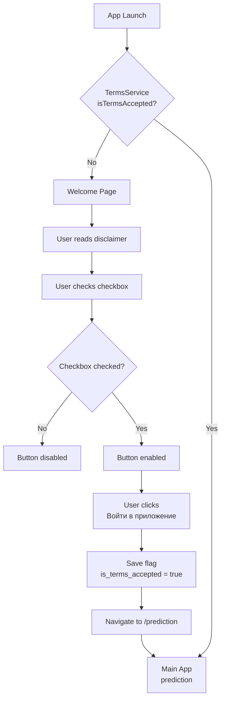
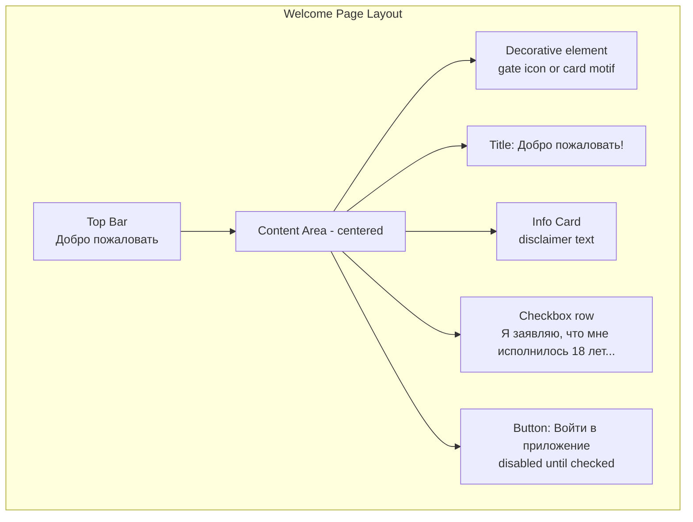

# Welcome / Terms Acceptance Page — Implementation Plan

## Overview

Create a welcome/terms acceptance page that appears on the **very first launch** of the app. The page must:
- Inform the user that the app is for entertainment purposes only
- Require the user to check a checkbox confirming they are 18+ and accept the terms
- Enable the "Enter" button only after the checkbox is checked
- Persist the acceptance flag (`is_terms_accepted = true`) in `localStorage`
- On subsequent launches, skip the welcome page and go directly to the main app

---

## Architecture

### 1. New Service: `TermsService`

**File:** `src/app/services/terms.ts`

A simple service that manages the `is_terms_accepted` flag in `localStorage`.

```typescript
@Injectable({ providedIn: 'root' })
export class TermsService {
  private readonly TERMS_KEY = 'cardGameTermsAccepted';

  isTermsAccepted(): boolean {
    return localStorage.getItem(this.TERMS_KEY) === 'true';
  }

  acceptTerms(): void {
    localStorage.setItem(this.TERMS_KEY, 'true');
  }
}
```

**Why `localStorage`?** The existing app already uses `localStorage` extensively (see `premium.ts`, `attempt.ts`). Since this is a web-first Angular app with Capacitor wrapper, `localStorage` is the correct choice — it persists on device via WebView storage. No need for `@capacitor/preferences`.

---

### 2. New Page: `WelcomePage`

**Files:**
- `src/app/pages/welcome/welcome.ts`
- `src/app/pages/welcome/welcome.html`
- `src/app/pages/welcome/welcome.scss`

#### Component Logic (`welcome.ts`)

```typescript
@Component({
  selector: 'app-welcome',
  standalone: true,
  imports: [CommonModule, RouterLink],
  templateUrl: './welcome.html',
  styleUrl: './welcome.scss'
})
export class WelcomePage {
  isChecked = false;

  constructor(
    private termsService: TermsService,
    private router: Router
  ) {}

  onCheckboxChange(event: Event): void {
    this.isChecked = (event.target as HTMLInputElement).checked;
  }

  enterApp(): void {
    this.termsService.acceptTerms();
    this.router.navigateByUrl('/prediction');
  }
}
```

#### Template (`welcome.html`)

Layout structure (top to bottom):
1. **Top-bar** — keep the existing `<app-top-bar>` (it's in `app.html`, so it's always visible)
2. **Welcome container** — centered content with:
   - A decorative element (gate image from `assets/ui/gate.png` or a subtle icon)
   - Title: "Добро пожаловать!"
   - Info card with the disclaimer text
   - Checkbox row with label
   - "Войти в приложение" button (disabled until checkbox is checked)

#### Styles (`welcome.scss`)

- Full viewport height, no bottom padding (since bottom-bar is hidden)
- Use the same color palette as the rest of the app:
  - Background: `linear-gradient(180deg, #F5F8FC 0%, #EBF0F7 100%)` (inherited from body)
  - Card background: `rgba(255, 255, 255, 0.95)` with `backdrop-filter: blur(10px)`
  - Primary button: `#007AFF` (iOS blue, same as other buttons)
  - Text colors: `#0a1e3d` (dark navy), `#3a3a4a` (secondary)
  - Font: `-apple-system, BlinkMacSystemFont, 'SF Pro Text', ...` for UI, `'EBGaramond', serif` for body text

---

### 3. Route Configuration

**File:** `src/app/app.routes.ts`

Add a new route for the welcome page:

```typescript
{ path: 'welcome', component: WelcomePage },
```

Change the default redirect to check terms first. Since Angular routes don't support conditional redirects natively, we have two approaches:

**Approach A (Recommended): Route Guard**

Create a `TermsGuard` that checks `TermsService.isTermsAccepted()`:
- If `true` → allow navigation to the requested route
- If `false` → redirect to `/welcome`

```typescript
@Injectable({ providedIn: 'root' })
export class TermsGuard implements CanActivate {
  constructor(private termsService: TermsService, private router: Router) {}

  canActivate(): boolean | UrlTree {
    if (this.termsService.isTermsAccepted()) {
      return true;
    }
    return this.router.parseUrl('/welcome');
  }
}
```

Apply this guard to the main routes (`prediction`, `collection`, `question`).

The default route `''` can redirect to `'prediction'` as before — the guard will handle the redirect to `/welcome` if terms aren't accepted.

**Approach B (Simpler):** Handle in `App` component's `ngOnInit` — check terms and navigate to `/welcome` if not accepted. But this causes a flash of the main page. Guard is cleaner.

**Recommendation: Approach A** with the guard.

---

### 4. App Component Changes

**File:** `src/app/app.html`

The bottom-bar should be hidden on the welcome page. Two options:

**Option 1 (Recommended):** Use `*ngIf` on bottom-bar based on current route.

In `app.ts`:
```typescript
export class App {
  showBottomBar = true;

  constructor(private router: Router) {
    this.router.events.pipe(
      filter(event => event instanceof NavigationEnd)
    ).subscribe((event: NavigationEnd) => {
      this.showBottomBar = event.urlAfterRedirects !== '/welcome';
    });
  }
}
```

In `app.html`:
```html
<app-top-bar></app-top-bar>
<router-outlet></router-outlet>
<app-bottom-bar *ngIf="showBottomBar"></app-bottom-bar>
```

**Option 2:** Use route data / CSS to hide it. Option 1 is cleaner.

**File:** `src/app/app.scss`

Remove the `padding-bottom` on `body` when on the welcome page, or better — make the bottom padding conditional. Since the welcome page has its own `padding-bottom: 0`, we can just ensure the welcome page container doesn't have extra bottom padding.

Actually, the simplest approach: **keep `body` padding as-is** but make the welcome page container compensate with negative margin or `min-height: calc(100vh - ...)`. Even simpler: just set `padding-bottom: 0` on the welcome container and use `min-height: 100vh` — the body padding will just create empty space below, which is fine since the welcome page has no bottom bar.

**Better approach:** Conditionally remove body padding when on welcome page. We can do this by adding/removing a CSS class on the body element from the App component.

---

### 5. Top-Bar on Welcome Page

The top-bar currently shows "Карта дня" as the title. On the welcome page, we should either:
- Change the title to something appropriate (e.g., "Добро пожаловать")
- Or hide the top-bar entirely

**Recommendation:** Keep the top-bar visible but change its title based on the route. The top-bar already has route-aware logic (it checks for `/collection`). We can extend it to show a different title on `/welcome`.

In `top-bar.ts`:
```typescript
get title(): string {
  if (this.router.url.startsWith('/welcome')) return 'Добро пожаловать';
  if (this.router.url.startsWith('/collection')) return 'Коллекция';
  if (this.router.url.startsWith('/question')) return 'Оракул';
  return 'Карта дня';
}
```

---

## Visual Layout (Mermaid)



---

## Page Layout (Mermaid)



---

## Implementation Steps (in order)

### Step 1: Create `TermsService`
- File: `src/app/services/terms.ts`
- Methods: `isTermsAccepted()`, `acceptTerms()`
- Uses `localStorage` with key `cardGameTermsAccepted`

### Step 2: Create `TermsGuard`
- File: `src/app/guards/terms.guard.ts`
- Implements `CanActivate`
- Checks `TermsService.isTermsAccepted()`
- Redirects to `/welcome` if not accepted

### Step 3: Create `WelcomePage` component
- Files in `src/app/pages/welcome/`
- Template with:
  - Centered layout with flexbox
  - Decorative image (gate or card back)
  - Title
  - Info card with disclaimer text (white card with blur)
  - Custom checkbox styled to match iOS
  - Primary button "Войти в приложение"
- Logic:
  - `isChecked` boolean bound to checkbox
  - Button `[disabled]="!isChecked"`
  - `enterApp()` calls `termsService.acceptTerms()` then navigates to `/prediction`

### Step 4: Update routes
- Add `WelcomePage` route: `{ path: 'welcome', component: WelcomePage }`
- Apply `TermsGuard` to `prediction`, `collection`, `question` routes
- Keep default redirect to `prediction`

### Step 5: Update `App` component
- Inject `Router`
- Subscribe to `NavigationEnd` events
- Set `showBottomBar` flag — hide on `/welcome`
- Add `*ngIf="showBottomBar"` to `<app-bottom-bar>` in `app.html`

### Step 6: Update `TopBarComponent`
- Add a `title` getter that returns appropriate title based on current route
- For `/welcome` → "Добро пожаловать"

### Step 7: Update `app.scss` body padding
- Either make bottom padding conditional via a CSS class on body
- Or ensure welcome page handles its own spacing (simpler: just let the body padding be, the welcome page content sits above it)

---

## Design Details

### Color Palette (consistent with existing app)
| Element | Value |
|---------|-------|
| Background | `linear-gradient(180deg, #F5F8FC 0%, #EBF0F7 100%)` |
| Card background | `rgba(255, 255, 255, 0.95)` |
| Card blur | `backdrop-filter: blur(10px)` |
| Primary text | `#0a1e3d` |
| Secondary text | `#3a3a4a` / `#636366` |
| Button (enabled) | `#007AFF` |
| Button (disabled) | `rgba(0, 122, 255, 0.4)` |
| Checkbox active | `#007AFF` |
| Font (UI) | `-apple-system, BlinkMacSystemFont, 'SF Pro Text', ...` |
| Font (body) | `'EBGaramond', serif` |

### Responsive Breakpoints
Follow the same breakpoints as the rest of the app:
- Default: > 768px
- Tablet/mobile: ≤ 768px
- Small mobile: ≤ 480px
- Very small: ≤ 360px

### Checkbox Styling
Use a custom-styled checkbox (hide native input, use a styled `div`/`span` with checkmark) to match iOS aesthetics, similar to how the rest of the app handles UI elements.

---

## Files to Create
| # | File | Purpose |
|---|------|---------|
| 1 | `src/app/services/terms.ts` | Terms acceptance service |
| 2 | `src/app/guards/terms.guard.ts` | Route guard for terms check |
| 3 | `src/app/pages/welcome/welcome.ts` | Welcome page component |
| 4 | `src/app/pages/welcome/welcome.html` | Welcome page template |
| 5 | `src/app/pages/welcome/welcome.scss` | Welcome page styles |

## Files to Modify
| # | File | Change |
|---|------|--------|
| 1 | `src/app/app.routes.ts` | Add welcome route + guards |
| 2 | `src/app/app.ts` | Add route-aware bottom bar visibility |
| 3 | `src/app/app.html` | Add `*ngIf` to bottom-bar |
| 4 | `src/app/components/top-bar/top-bar.ts` | Dynamic title for welcome page |
